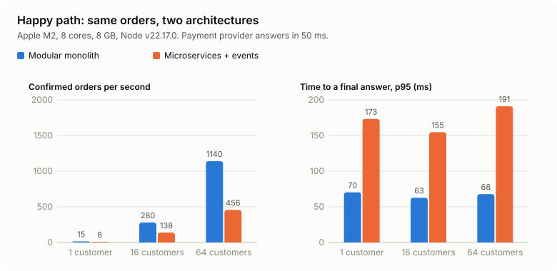
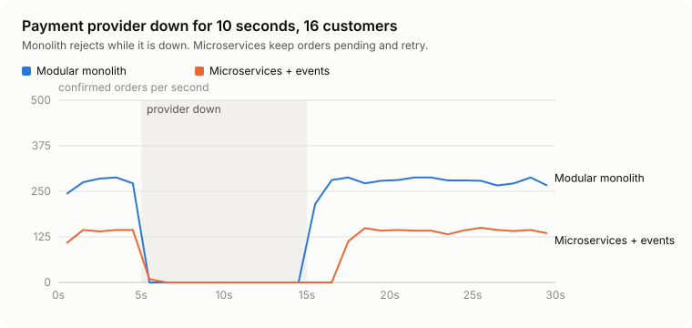
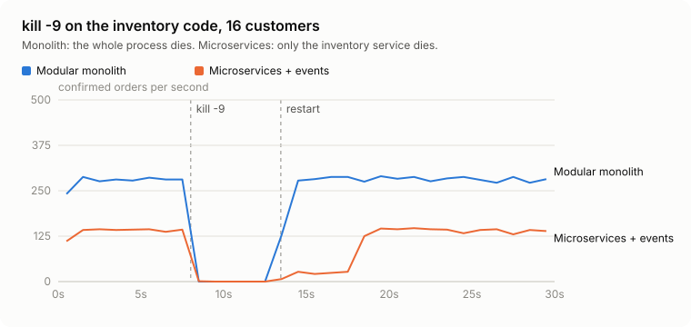

# tradeoff-lab

English | [ภาษาไทย](README.th.md)

The same order system built twice, once as a modular monolith and once as event-driven microservices, then load-tested and broken on purpose. Use it to argue about architecture with numbers instead of opinions.

[](https://github.com/nuttakulsv/tradeoff-lab/actions/workflows/ci.yml)
[](LICENSE)




|                                                             | Modular monolith | Microservices + events |
| ----------------------------------------------------------- | ---------------: | ---------------------: |
| Confirmed orders/s, 64 customers                            |        **1,140** |                    456 |
| Time to a final answer, p95                                 |        **68 ms** |                 191 ms |
| Payment provider down 10 s: orders rejected                 |              320 |                  **0** |
| Payment provider down 10 s: longest wait                    |        **0.5 s** |                 12.3 s |
| `kill -9` mid-order: failed requests                        |            1,556 |                  **0** |
| Oversold stock, double charges, lost orders (all scenarios) |                0 |                      0 |
| Memory at idle                                              |       **111 MB** |  511 MB + 33 MB broker |
| Deployable units / containers / env vars                    |    **1 / 3 / 3** |             5 / 8 / 16 |

One Apple M2 laptop (8 cores, 8 GB), everything local. Full tables in [results/summary.md](results/summary.md), method below.

Neither column wins. The monolith is faster, smaller and easier to run. The event-driven version never turned a customer away when a dependency failed, at the price of making some of them wait. Which of those matters more is a product decision, and that is the point.

## Quick start

```bash
git clone https://github.com/nuttakulsv/tradeoff-lab.git
cd tradeoff-lab && npm install
npm run lab -- contract all
```

```console
monolith: up in 479 ms, running contract tests
 Test Files  1 passed (1)
      Tests  11 passed (11)
microservices: up in 486 ms, running contract tests
 Test Files  1 passed (1)
      Tests  11 passed (11)
```

No Docker needed. The lab starts a real PostgreSQL 18 from the [`embedded-postgres`](https://github.com/leinelissen/embedded-postgres) package and downloads a pinned `nats-server` binary into `.lab/`. Node 22.12 or newer.

| Command                        | What it does                                                                          |
| ------------------------------ | ------------------------------------------------------------------------------------- |
| `npm run lab -- contract all`  | Run the black-box contract tests against both variants                                |
| `npm run lab -- run all crash` | Run one scenario on both variants (add `--quick` for a 20% run)                       |
| `npm run bench`                | Every scenario on both variants, then rebuild the report and charts (about 9 minutes) |
| `npm run lab -- up monolith`   | Start a variant and leave it running on port 4000 (microservices: 4100)               |

With Docker instead:

```bash
docker compose --profile monolith up --build --wait        # http://localhost:4000
docker compose --profile microservices up --build --wait   # http://localhost:4100
```

## What is compared

A small shop: place an order (reserve stock, charge a payment provider, confirm), cancel it (refund, put stock back), read orders, and send a confirmation. Both variants implement the same [OpenAPI spec](openapi.yaml) and pass the same [contract tests](contract/orders.contract.ts).

**Modular monolith.** One NestJS process. Modules for orders, inventory, payments and notifications, each with its own schema in one PostgreSQL database. Placing an order reserves stock in the same transaction, calls the provider, and answers `201 CONFIRMED` or `201 REJECTED`. A recovery job finishes orders that were interrupted by a crash.

**Microservices, event-driven.** Five processes (gateway, orders, inventory, payments, notifications), four databases, NATS JetStream in between. The order service answers `202 PENDING` straight away and a saga drives the order to its final state, with an outbox in every service, idempotent consumers, and compensation when payment fails.

[docs/architecture.md](docs/architecture.md) has sequence diagrams of both. The code that both share (request schemas, SQL, the payment client) lives in `src/shared/`, so differences come from structure, not from one side having better queries ([why](docs/decisions/0004-shared-code.md)).

## Method

- A closed-loop load generator ([harness/load.ts](harness/load.ts)): each virtual customer places an order, polls every 50 ms until it is CONFIRMED or REJECTED, then places the next one. "Time to a final answer" is what the customer waits. For the 202 variant this includes polling, so the [full results](results/summary.md) also show server-side time without it.
- After every scenario, [harness/check.ts](harness/check.ts) reads the databases and the payment provider's ledger and counts stuck orders, duplicate orders, leaked or oversold stock, money taken without an order, orders confirmed without money, and missing notifications. Every run in this README came back clean on all of them.
- The fake payment provider answers in 50 ms by default and can be made slow, failing or down at runtime.
- Each scenario starts from empty databases and a fresh broker.

| Scenario                | What happens                                                                                            |
| ----------------------- | ------------------------------------------------------------------------------------------------------- |
| baseline-c1 / c16 / c64 | Happy path with 1, 16 and 64 customers for 20 s                                                         |
| hot-item                | 32 customers race for 100 mooncake boxes                                                                |
| slow-payment            | The provider takes 2 s per charge                                                                       |
| payment-outage          | The provider is down from 5 s to 15 s                                                                   |
| crash                   | `kill -9` on the inventory code at 8 s, restart at 13 s. In the monolith that is the whole process      |
| duplicates              | Every HTTP request sent twice at once; in the microservices variant every event is also published twice |

## Results

On the happy path the monolith does 2 to 2.5 times the orders per second and answers in under half the time. Each order in the event-driven version crosses four hops (database transaction, outbox poll, broker) before it is confirmed. Its POST returns faster (10 to 25 ms at p95), but that only means the customer starts waiting sooner.

When the bottleneck is someone else's API, the architecture stops mattering for throughput. With a 2 s payment provider both variants did about 15 orders per second with 32 customers. Both waited about 2.1 to 2.4 s per order.

Both variants sold exactly 100 mooncake boxes in the hot-item race, and neither charged anyone twice in the duplicates scenario.

### When things break



With the payment provider down, the monolith did what you would expect from a synchronous call. It tried three times over about 0.45 s, then rejected the order with `PAYMENT_UNAVAILABLE`: 320 rejected orders, each customer told within half a second. The event-driven version held every order as PENDING and kept retrying with backoff. Nobody was rejected, 16 customers waited up to 12.3 s, and every order was confirmed. It took about 2 s after the provider came back to catch up, because of the backoff.



Killing the monolith takes everything down: 1,556 requests failed while it was gone. Orders caught in the middle of a payment were finished by the recovery job about 6 s after the restart. Killing only the inventory service failed no requests at all, but confirmations stopped for everyone, because every order needs stock. 16 customers waited up to 10.2 s. The slow climb after the restart is JetStream's `ack_wait`: messages the dead process had taken are handed out again only after 10 s. With the NATS default of 30 s, an earlier (shorter) run took 29 s to recover. Another run of this scenario recovered in 22 ms, because the kill happened when no message was in flight. Crash results depend on timing; run them more than once.

### Cost of running and changing it

|                                               | Monolith | Microservices |
| --------------------------------------------- | -------: | ------------: |
| Own TypeScript (non-blank, non-comment lines) |      411 |           707 |
| Shared by both                                |      375 |           375 |
| Deployable units                              |        1 |             5 |
| Containers in docker-compose                  |        3 |             8 |
| App environment variables                     |        3 |            16 |
| Databases / brokers                           |    1 / 0 |         4 / 1 |
| Cold start of all processes                   |   370 ms |        556 ms |
| Add a discount code: files / lines changed    |   3 / 51 |        4 / 69 |

The discount code change ([exercises/discount-code](exercises/discount-code)) stayed inside one context in both variants, so the gap is small. CI applies both patches and runs the contract tests on them, so they keep working. A change that crosses contexts is the next exercise to add.

Rough monthly cloud cost for a small production setup with redundancy, using [DigitalOcean list prices](https://www.digitalocean.com/pricing/droplets) (checked 3 October 2026) at 1 USD = 33.5 THB (market rate on 2 October 2026):

|                                                                                                 |                Monolith |                      Microservices |
| ----------------------------------------------------------------------------------------------- | ----------------------: | ---------------------------------: |
| App servers                                                                                     |    2 × 2 vCPU/4 GB: $48 | 5 services × 2 × 1 vCPU/2 GB: $120 |
| Broker                                                                                          |                    none |          3 × 1 vCPU/2 GB NATS: $36 |
| [Managed PostgreSQL](https://www.digitalocean.com/pricing/managed-databases), primary + standby |    2 vCPU/4 GB: $121.80 | same cluster, 4 databases: $121.80 |
| Total                                                                                           | **$169.80 ≈ 5,690 THB** |            **$277.80 ≈ 9,310 THB** |

These are estimates from assumptions, not measurements: instance sizes are a guess at a small HA setup, load balancers and bandwidth are left out because both need the same, and giving each service its own database cluster would put the microservices total near $400 (13,390 THB). For most teams the bigger cost is people: on-call for eight containers and a broker, tracing across services, and the saga code itself.

## Which one should you pick?

| If this is true                                                      | It leans towards                                  |
| -------------------------------------------------------------------- | ------------------------------------------------- |
| One team, fewer than about 10 engineers                              | Modular monolith                                  |
| Most changes touch one area of the product                           | Either; the monolith is cheaper                   |
| Several teams that need to deploy independently                      | Microservices                                     |
| Losing an order during an outage costs more than a slow confirmation | Event-driven                                      |
| Customers need an immediate yes or no (checkout, ticketing)          | Monolith, or event-driven with a synchronous step |
| One part needs to scale or fail separately from the rest             | Microservices for that part                       |
| No tracing, no on-call, no one who has run a broker in production    | Modular monolith                                  |

A middle path the numbers support: start with the modular monolith, keep the module boundaries strict (no reaching into another module's tables), and add an outbox for the one flow where an outage must not lose orders. Split out a service when a team or a scaling need asks for it, not before.

## Limitations

- Everything ran on one laptop: databases, broker, eight Node processes and the load generator shared the CPU. Network hops between services are localhost, which makes the microservices numbers optimistic. Real networks add latency to every hop.
- One run per scenario. Crash timing in particular varies between runs.
- The monolith runs as one Node process. Running several replicas behind a load balancer would raise its throughput; the same is true for each microservice.
- The outbox relay polls every 10 ms. LISTEN/NOTIFY would cut latency per hop.
- The variants share code, which makes the change exercise kinder to microservices than a polyrepo setup would be.
- The cost table is an estimate, as described above.

Decisions behind the lab are in [docs/decisions](docs/decisions).

## Contributing

New variants are the most useful contribution: synchronous microservices over HTTP, Kafka, serverless. [CONTRIBUTING.md](CONTRIBUTING.md) explains how to add one and how to add scenarios and exercises. Please post the machine with any numbers you share.

## License

[MIT](LICENSE)
