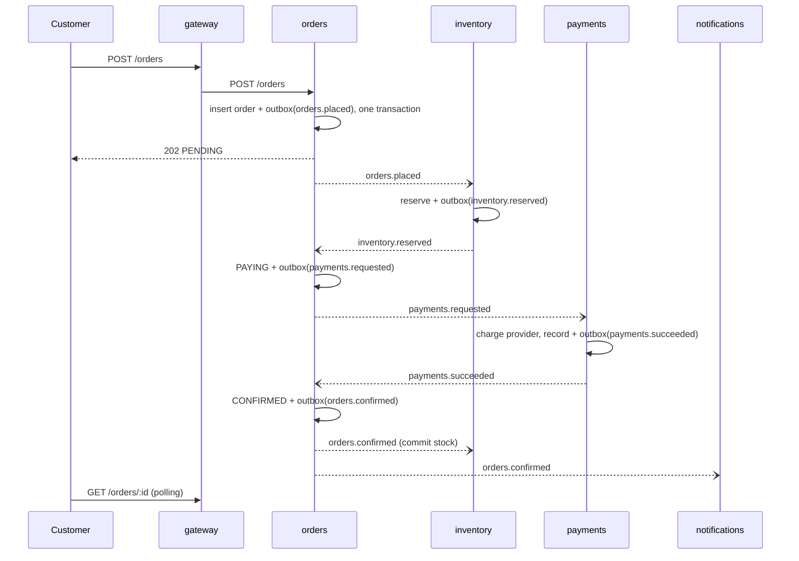

# How the two variants work

Both variants expose the same API (`openapi.yaml`) and use the same SQL for orders, stock and payments (`src/shared/`). What differs is where the boundaries are and how the parts talk.

## Modular monolith

One NestJS process, one PostgreSQL database with a schema per module (`orders`, `inventory`, `payments`, `notifications`). Modules call each other through their services, never through each other's tables.

```mermaid
sequenceDiagram
  participant C as Customer
  participant O as orders module
  participant I as inventory module
  participant P as payments module
  participant G as Payment provider
  participant N as notifications module
  C->>O: POST /orders
  O->>O: BEGIN
  O->>I: reserve(stock) in the same transaction
  O->>O: COMMIT (order PENDING, stock held)
  O->>P: charge(order)
  P->>G: POST /charges (Idempotency-Key = order id)
  G-->>P: captured
  O->>O: BEGIN; CONFIRMED; commit stock; record payment; COMMIT
  O-->>C: 201 CONFIRMED
  O--)N: order.confirmed (in-process event)
```

- Stock and the order are written in one transaction, so "stock taken but no order" cannot happen.
- The customer waits for the payment provider. A slow provider is a slow API.
- If the process dies after the charge and before the commit, the order stays PENDING with stock held. `RecoveryService` asks the provider what happened to orders older than `RECOVERY_AFTER_MS` and finishes them.
- Notifications are in-process events: fast, but lost if the process dies between commit and handler. The checks count these as `missing notification`.

Code: `src/monolith/`.

## Microservices, event-driven

Five processes: `gateway`, `orders`, `inventory`, `payments`, `notifications`. Each service owns its database. They talk only through events on NATS JetStream.



- **Saga.** `orders` runs the place-order process as a state machine (`src/microservices/orders/saga.ts`). A failed payment emits `orders.rejected`, and inventory puts the stock back (the compensation).
- **Outbox.** Every service writes its outgoing events to `messaging.outbox` in the same transaction as its state change. A relay publishes them with the event id as the JetStream message id, so a retry after a crash is de-duplicated.
- **Inbox.** Every consumer records handled event ids in `messaging.inbox` in the same transaction as its effect, so a redelivered or duplicated event has no second effect.
- **Retries without a waiting customer.** When the provider is down, `payments` retries with backoff for up to `PAYMENT_RETRY_WINDOW_MS` (60 s) before it gives up.
- **Latency per hop.** Each hop costs a transaction, an outbox poll (`OUTBOX_POLL_MS`, 10 ms) and a broker round trip. The happy path has four hops before CONFIRMED.

Code: `src/microservices/`.

## What the checks look at

After every scenario `harness/check.ts` reads the databases and the payment provider's ledger:

| Check                   | Meaning                                                                |
| ----------------------- | ---------------------------------------------------------------------- |
| stuck                   | orders still PENDING or CANCELLING after the system had time to settle |
| duplicate orders        | two orders for one Idempotency-Key                                     |
| stock leaked / oversold | units missing from the shelf without a confirmed order, or sold twice  |
| charged, no order       | money captured and not refunded, but the order is not CONFIRMED        |
| confirmed, no charge    | a CONFIRMED order with no captured payment                             |
| missing notification    | a CONFIRMED order the customer was never told about                    |
